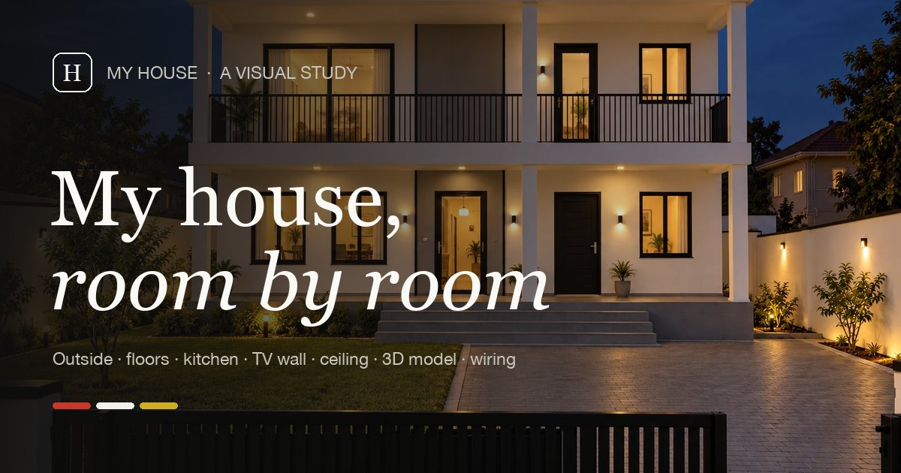

# My House

[](https://github.com/mubahood/my-house/actions/workflows/pages.yml)

Everything about the house in one place: the photo gallery, the 3D model, the wiring budget and the written design notes.

**Live site: [mubahood.github.io/my-house](https://mubahood.github.io/my-house/)** · [Wiring budget](https://mubahood.github.io/my-house/wiring.html) · [3D model](https://mubahood.github.io/my-house/model/3d-model.html) · [Notes](https://mubahood.github.io/my-house/docs/)

[](https://mubahood.github.io/my-house/)

**Offline:** open `index.html` in a browser. Everything works from the folder except the 3D model, which loads its 3D library from the internet.

## Folders

```
my-house/
├── index.html              the photo gallery
├── wiring.html             the pipe work and wiring budget, a photo of every item
├── 404.html                the page for addresses that do not exist (on the live site)
├── assets/
│   ├── photos.js           the photo list: titles, descriptions, which floor
│   ├── gallery.css         the look
│   ├── gallery.js          the behaviour: filters, search, viewer, saving
│   ├── wiring-data.js      the wiring budget: items, quantities, prices, photo sources
│   ├── wiring.css          the budget page look, on top of gallery.css
│   ├── wiring.js           the budget page behaviour: totals, ticks, list view, viewer
│   ├── favicon.svg         the H mark in the browser tab
│   └── social.jpg          the picture shown when a link to the site is shared
├── images/                 web images used by the gallery (WebP)
│   ├── outside/            front, garden view, back, night
│   ├── ground-floor/       living hall, stair, kitchen, bedrooms 2 and 3, guest bedroom, Room 4
│   ├── kitchen/            seven finish directions for the same kitchen
│   ├── upper-floor/        gallery and open lounge, master bedroom, en suite, home office
│   ├── tv-wall/            the six TV wall designs
│   ├── ceiling/            six ceiling concepts in side view, with the crystal chandelier
│   ├── wiring/             product photos for the wiring budget, one per item (square, 1000 px)
│   ├── first-ideas/        the first, exaggerated images, kept for comparison
│   └── <each>/thumbs/      small copies for the grid, 760 px wide (520 px square for wiring)
├── originals/              the original images and references, same names and folders
├── model/
│   └── 3d-model.html       interactive 3D model (needs internet to load)
└── docs/
    ├── index.html          the notes reader: shows each .md file in the house style
    ├── 01-architectural-description.md
    ├── 02-corrections-for-the-image-ai.md
    ├── 03-tv-wall-ideas.md
    ├── 04-image-ai-command-tv-wall.md
    ├── 05-ceiling-ideas.md
    └── 06-kitchen-ideas.md
```

## Naming

Every image is `NN-what-it-shows.webp`, numbered in the order you would walk through the house. The same name is used in `images/`, `images/<floor>/thumbs/` and `originals/`, so the three copies always match.

## Adding a new photo

1. Save the original in `originals/<floor>/NN-name.png`.
2. Make a WebP copy at full size in `images/<floor>/`, and one 760 px wide in `images/<floor>/thumbs/`.
3. Add one line to `assets/photos.js` with the title, a one line description and the alt text.

## Using the gallery

- **Top bar:** one glass line, always fixed at the top. All photos sit in one grid, four per row. The room names (All, Outside, Ground floor, Kitchen, Upper floor, TV wall, Ceiling) filter it, and a line slides under the active one. A thin line under the bar shows how far down the page you are.
- **Search (/ or Ctrl+K):** one box for everything. Type a room, a floor or a file and press Enter. The arrow keys move through the results.
- **Before (B):** shows the first, exaggerated images. Hover over one to see the corrected final.
- **Saved (heart):** keeps your favourites in this browser. The heart in the top bar shows only those.
- **Archive (box):** put away the photos you no longer want to see. Archived photos leave the rooms and wait in the archive, faded to grey, until you restore them one by one or all at once. Every archive or restore can be undone from the message that appears. The archive is remembered in this browser (local storage, with a cookie as a backup). The search box can also copy the archived file names, so they can be moved into a folder on disk.
- **Menu (three lines):** the 3D model, the wiring budget, the notes and the keyboard keys.
- **Viewer:** click any photo.
  - The arrow keys or a swipe move between photos, and the strip along the bottom jumps to any of them.
  - **C** compares with a slider: drag the line between the first idea and the final.
  - **Z** or a click zooms in. Move the pointer to look around.
  - **S** saves, **A** archives or restores, **F** goes full screen, **Esc** closes.
- **Links:** an open photo's address ends in, for example, `#ground-floor/03-kitchen`; `#kitchen` and `#ceiling` open their design collections. Both work when shared.

## How the code is organised

- `assets/photos.js`: data only. The six groups and every photo.
- `assets/gallery.css`: ten numbered parts, from tokens (colours, fonts, spacing) through the navigation, rooms, palette and viewer, to the responsive rules.
- `assets/gallery.js`: eight numbered parts: data, state and storage, grid, header and filters, modes, palette, viewer, then keys and start-up. It uses no libraries and works when opened straight from the folder.

## Wiring budget (`wiring.html`)

Every item on the electrician's pipe work and wiring paper, with a photo, quantity, price each and line total in UGX (labour and transport excluded).

- **Where the money goes:** one bar, a segment per item, coloured like the thing itself. Point at a segment to find its card.
- **Mark bought:** tick items as they arrive; the ring shows how much of the money is spent. Remembered in this browser.
- **Cards / List:** photo cards or a receipt list. **Print** prints the receipt.
- **Check the paper:** items 18 and 19 are hard to read. Choose a reading and every total follows. Change the figures for good in `assets/wiring-data.js`.
- Photos are product pictures from public listings, saved in `images/wiring/` with the originals in `originals/wiring/`. The source of each is in `wiring-data.js` and shown in the photo viewer.

## Publishing

The site is published to GitHub Pages by `.github/workflows/pages.yml` on every push to `main`. It copies everything except `originals/` and this README, so the live site stays small (about 10 MB). To publish a change:

```
git add -A
git commit -m "Describe the change"
git push
```

The new version is live a minute or two later. The run is listed under the repository's **Actions** tab.
